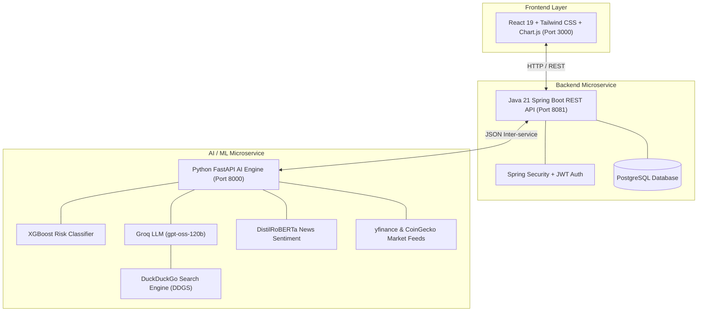

# Smart Invest - AI-Powered Investment Guidance Platform 📈

[](https://github.com/Vansh-2102/smart-invest-)
[]()

**Smart Invest** is a full-stack, enterprise-grade AI-powered financial advisory microservices platform. It empowers retail investors with personalized machine-learning risk scoring, automated asset allocation portfolios, real-time technical market analysis, financial news sentiment tracking, and a live web-augmented AI financial advisor chatbot.

---

## 🌐 Live Deployed Application URLs

| Service / Component | Hosting Platform | Environment | Live Production URL | Health Check / Documentation |
| :--- | :--- | :---: | :--- | :---: |
| **Frontend Web App** | **Vercel** | Production | **`https://smart-invest-.vercel.app`** | Active SPA UI |
| **Backend REST API** | **Render** | Production | **`https://smart-invest-backend-z3gg.onrender.com`** | [`/healthz`](https://smart-invest-backend-z3gg.onrender.com/healthz) |
| **ML & AI Engine** | **Render** | Production | **`https://smart-invest-ml.onrender.com`** | [`/healthz`](https://smart-invest-ml.onrender.com/healthz) \| [`/docs`](https://smart-invest-ml.onrender.com/docs) |
| **Relational Database** | **Supabase** | Cloud (AWS) | `aws-0-ap-southeast-2.pooler.supabase.com` | PostgreSQL 17 (Pooler) |
| **24/7 Keep-Alive Monitor** | **UptimeRobot** | Monitoring | Continuous 5-min ping on `/healthz` | 0% Downtime Heartbeat |

> 📌 **Swagger / OpenAPI Documentation:** Explore and test the live ML microservice endpoints directly at **[https://smart-invest-ml.onrender.com/docs](https://smart-invest-ml.onrender.com/docs)**.

---

## 🌟 Key Features & Core Working Mechanics

### 1. 📊 ML Risk Assessment Model
* **Algorithm**: Supervised **XGBoost Classifier (`XGBClassifier`)**.
* **Working Principle**: Evaluates user financial demographics (`age`, `annual_income`, `investment_experience`, `risk_tolerance`, `investment_goal`, `time_horizon`, `debt_to_income`).
* **Preprocessing**: Uses `StandardScaler` for numerical scaling and `LabelEncoder` for categorical encoding.
* **Output**: Predicts user risk tolerance (`Conservative`, `Moderate`, `Aggressive`) with multi-class probability scores.

### 2. 💬 AI Financial Advisor Chatbot (Web-Augmented LLM)
* **LLM Engine**: **Groq LLM (`llama-3.3-70b-versatile`)** for ultra-fast, high-precision inference.
* **Live Search Integration**: Integrates **DuckDuckGo Search Engine (`DDGS`)** to fetch live financial news, stock prices, and market developments.
* **Strict Topic Guardrails**: Enforces system prompt guardrails that strictly restrict responses to personal finance, stocks, crypto, banking, tax, and economy. Non-financial queries (e.g. sports, movies, cooking) are automatically declined.

### 3. 📰 Financial News Sentiment Analysis
* **Model**: Fine-Tuned **DistilRoBERTa** (`distilroberta-finetuned-financial-news-sentiment-analysis`).
* **Working Principle**: Cleans raw news headlines using regex and classifies text sentiment into `positive`, `negative`, or `neutral` with confidence scores.

### 4. 💼 Investment Recommendation Engine
* **Strategy**: Implements **Modern Portfolio Theory (MPT)** and risk-balanced capital distribution matrices.
* **Capital Allocation**:
  * **Conservative**: 30% Stocks, 50% Bonds, 10% Cash, 10% Gold (e.g. `SPY`, `BND`, `GLD`, `JNJ`).
  * **Moderate**: 55% Stocks, 30% Bonds, 10% Cash, 5% Gold (e.g. `SPY`, `QQQ`, `AAPL`, `MSFT`).
  * **Aggressive**: 80% Stocks, 10% Bonds, 5% Cash, 5% Gold (e.g. `QQQ`, `SMH`, `NVDA`, `TSLA`).
* **Quantitative Analysis**: Queries `yfinance` to compute 1-year historical returns %, annualized volatility %, and exact share units to purchase.

### 5. 📈 Market Analysis Engine
* **Real-Time Feeds**: Connects to `yfinance` and **CoinGecko API** for live feeds across 5 market segments:
  * **Equities**: Top NSE Indian stocks (Reliance, TCS, HDFC Bank, Infosys) with P/E ratios and Market Cap.
  * **Indices**: NIFTY 50, SENSEX, NIFTY Bank, S&P 500, NASDAQ.
  * **Gold**: Live spot rates converted from USD/oz to INR per 10g using USD/INR FX rates (`INR=X`), Sovereign Gold Bonds (SGB), and Gold ETFs.
  * **Crypto**: Bitcoin, Ethereum, Solana live prices, 24h change %, and volume in INR.
  * **Mutual Funds**: Curated funds across Large Cap, Mid Cap, Flexi Cap, and ELSS.
* **Technical Indicators (Pandas/NumPy)**:
  * **Simple Moving Averages (MA20, MA50, MA200)**: Trend direction analysis.
  * **Relative Strength Index (RSI 14)**: 14-day momentum oscillator detecting overbought (>70) and oversold (<30) conditions.
  * **MACD**: Exponential Moving Average divergence ($EMA_{12} - EMA_{26}$) with a 9-day signal line.

---

## 🏗️ System Architecture & Workflow



---

## 🛠️ Tech Stack Table

| Category | Technologies / Tools |
| :--- | :--- |
| **Frontend** | React 19, Vite, Tailwind CSS, Chart.js (`react-chartjs-2`), Lucide Icons, Axios |
| **Backend API** | Java 21, Spring Boot 3.3.3, Spring Security, JWT, Spring Data JPA, Lombok, OpenAPI/Swagger |
| **ML & AI Engine** | Python 3.10+, FastAPI, Uvicorn, XGBoost, Scikit-Learn, PyTorch, Hugging Face, LangChain |
| **LLM & Search** | Groq (`ChatGroq` - `llama-3.3-70b-versatile`), DuckDuckGo Web Search (`DDGS`) |
| **NLP Sentiment** | DistilRoBERTa (`mrm8488/distilroberta-finetuned-financial-news-sentiment-analysis`) |
| **Market Data APIs** | `yfinance` (NSE Stocks, Global Indices, Gold, FX), CoinGecko API (Crypto) |
| **Database** | PostgreSQL |

---

## 🔌 API Endpoints Summary

### ML Service Endpoints
* **Production Base URL:** `https://smart-invest-ml.onrender.com`
* **Local Base URL:** `http://localhost:8000`

| Method | Endpoint | Description |
| :--- | :--- | :--- |
| `GET` / `HEAD` | `/healthz` | Uptime keep-alive & service health heartbeat |
| `POST` | `/api/risk/assess` | Evaluates user profile and predicts risk level via XGBoost with SHAP attribution |
| `POST` | `/api/investment/recommend` | Friction-aware SLSQP continuous portfolio optimization & tax deductions |
| `POST` | `/api/investment/rebalance/consent` | Opt-in consent handler for market volatility shock rebalancing |
| `POST` | `/api/investment/post-tax-calculate` | Post-Budget 2024 LTCG, Sec 115BBH VDA & Sec 194A TDS calculations |
| `POST` | `/api/market/confirmed-signal` | Composite RSI momentum + FinBERT sentiment confirmation filter |
| `POST` | `/api/chat` | AI Financial Advisor Chatbot (Groq LPU LLaMA 3.3 70B + DuckDuckGo Search) |
| `GET` | `/api/market/analyze/{ticker}` | Returns price history & technical indicators (MA, RSI, MACD) |
| `GET` | `/api/market/stocks` | Top NSE Indian stock prices, P/E ratios, and market caps |
| `GET` | `/api/market/indices` | Live global and domestic market index metrics (NIFTY, SENSEX, India VIX) |
| `GET` | `/api/market/gold` | Live spot gold price in INR/10g, SGB rates & ETF options |
| `GET` | `/api/market/crypto` | Live crypto prices (BTC, ETH, SOL, XRP, ADA) in INR with Yahoo Finance fallback |

### Backend Service Endpoints
* **Production Base URL:** `https://smart-invest-backend-z3gg.onrender.com`
* **Local Base URL:** `http://localhost:8081`

| Method | Endpoint | Description |
| :--- | :--- | :--- |
| `GET` / `HEAD` | `/healthz` | Uptime keep-alive & service health heartbeat |
| `POST` | `/api/auth/register` | User registration & BCrypt password hashing |
| `POST` | `/api/auth/login` | Authentication & JWT token issuance |
| `POST` | `/api/profile` | Create/Update financial profile & trigger ML risk scoring |
| `POST` | `/api/recommendations` | Generate & persist user portfolio recommendations |
| `POST` | `/api/chat/send` | Chat proxy service logging user and AI responses |

---

## 🚀 Installation & Local Setup

### Prerequisites
* **Java 21 SDK** & **Maven**
* **Python 3.10+**
* **Node.js 18+** & **npm**
* **PostgreSQL Database**

### 1. ML Service Setup (`/ml`)
```bash
cd ml
pip install -r requirements.txt
# Copy environment file and configure GROQ_API_KEY
cp .env.example .env
uvicorn api.main:app --reload --port 8000
```

### 2. Backend Setup (`/backend`)
```bash
cd backend
./mvnw spring-boot:run
```
*Backend runs on `http://localhost:8081`.*

### 3. Frontend Setup (`/frontend`)
```bash
cd frontend
npm install
npm run dev
```
*Frontend runs on `http://localhost:3000`.*

---

## 🐳 Docker Compose Quickstart

Run all microservices concurrently in Docker:

```bash
docker compose up --build
```

---

## 📄 License & Author

* **Author**: [Vansh](https://github.com/Vansh-2102)
* **Repository**: [https://github.com/Vansh-2102/smart-invest-](https://github.com/Vansh-2102/smart-invest-)
